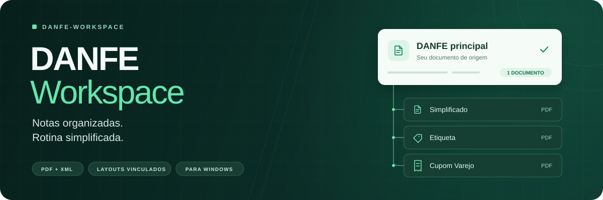
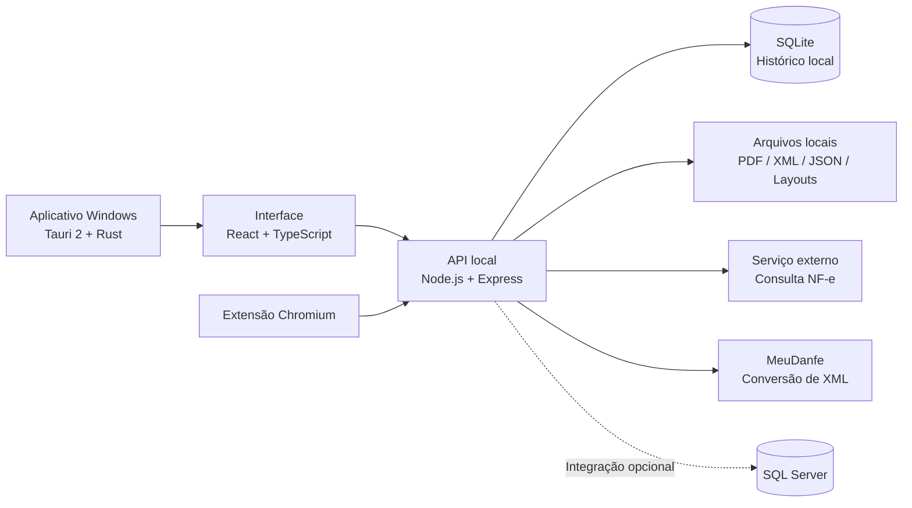

<div align="center">



# DANFE Workspace

**Documentos fiscais organizados. Processos simplificados.**

Aplicativo desktop para Windows que centraliza a consulta de NF-e, a geração de DANFEs, o processamento em lote e a organização dos arquivos — com histórico local, automações e layouts vinculados a cada documento.

<p>
  
  
  
  
  
</p>

[Visão geral](#visão-geral) · [Funcionalidades](#funcionalidades) · [Instalação e desenvolvimento](#instalação-e-desenvolvimento) · [Build e releases](#build-e-releases) · [Documentação](#documentação)

</div>

---

## Visão geral

O **DANFE Workspace** reúne diferentes etapas da rotina com documentos fiscais em uma única interface: da consulta de uma chave de acesso à organização dos PDFs gerados.

O aplicativo permite acompanhar o andamento de consultas e lotes, acessar logs, localizar documentos já processados e gerar formatos adicionais a partir dos XMLs disponíveis, sem precisar trabalhar com arquivos dispersos em várias pastas.

> [!IMPORTANT]
> A interface, o histórico e os arquivos gerados são mantidos no ambiente local. **A consulta fiscal e a conversão de XML dependem de serviços externos configurados.** A integração opcional com SQL Server também depende do acesso ao banco e à rede da operação.

## Funcionalidades

| Recurso | O que oferece |
| --- | --- |
| **Consulta de NF-e** | Pesquisa pela chave de acesso, com visualização e salvamento do DANFE. |
| **Processamento em lote** | Importação por texto, TXT ou dados tabulados; seleção de notas, acompanhamento do progresso e interrupção. |
| **Histórico inteligente** | Registro local em SQLite e identificação de documentos já processados para reduzir downloads repetidos. |
| **Gerenciador de arquivos** | Busca, visualização em lista ou grade, paginação, pré-visualização de PDF e acesso à pasta de origem. |
| **Múltiplos layouts** | Geração de DANFE Simplificado, Etiqueta e Cupom Varejo a partir do XML local. |
| **Consulta automática** | Pesquisa de notas no SQL Server em intervalos ou horários configurados, com download automático opcional. |
| **Extensão de navegador** | Identificação de chaves NF-e no texto copiado, com envio da captura para confirmação no aplicativo. |
| **Experiência desktop** | Temas claro/escuro, bandeja do sistema, status de serviços, logs em tempo real e atualização pelo próprio aplicativo. |

## Documentos e layouts

### Um documento principal, diferentes formatos

Na seção **Arquivos gerados**, cada DANFE principal concentra seus layouts adicionais no menu `⋯`. Os formatos podem ser visualizados ou baixados individualmente.

**Regra de contagem:** os indicadores consideram apenas os DANFEs principais. Assim, **1 DANFE principal + 3 layouts adicionais = 1 documento no contador principal**.

### Organização dos arquivos

A pasta de saída é configurável no aplicativo. A estrutura utilizada é:

```text
DANFE/
├── PDF/
│   └── 000001 - Empresa Exemplo.pdf
├── .XML/                 # XMLs de origem, quando disponíveis
├── .JSON/                # Respostas das consultas
└── .LAYOUTS/
    ├── simplificado/     # DANFE Simplificado
    ├── etiqueta/         # DANFE Etiqueta
    └── varejo/           # DANFE Cupom Varejo
```

As pastas `.XML`, `.JSON` e `.LAYOUTS` são marcadas como **ocultas no Windows**, mas continuam disponíveis para os processos internos do aplicativo.

No aplicativo nativo, a opção **Baixar** cria uma cópia na pasta **Downloads** do usuário, preservando o arquivo original. Nomes repetidos recebem sufixos como `(1)` e `(2)`. Na versão acessada pelo navegador, o destino depende das configurações de download do navegador.

### Geração de layouts a partir do XML

Os layouts adicionais usam o **XML armazenado localmente**, enviado aos endpoints de conversão do [MeuDanfe](https://meudanfe.com.br/documentacao). Segundo a documentação do provedor, essas conversões são gratuitas e exigem autenticação por API key.

Configure `MEUDANFE_API_KEY` em `BACKEND/.env`. O sistema localiza o XML pelo vínculo com a chave de acesso registrada no histórico. **Se o XML não estiver disponível, não é possível gerar o layout adicional por esse fluxo.**

Consulte os detalhes da integração no [README do backend](BACKEND/README.md).

## Como usar

1. **Configure a pasta de saída** nas configurações do aplicativo.
2. **Inicie uma consulta** pela chave de acesso, importe um lote ou utilize a consulta automática se o SQL Server estiver configurado.
3. **Acompanhe o processamento** pelo painel, indicadores de progresso e logs.
4. **Abra Arquivos gerados** para localizar e visualizar o PDF principal.
5. **Acesse os layouts** no menu `⋯` de cada documento e baixe uma cópia quando necessário.

## Arquitetura

O projeto combina uma interface React com uma API local Node.js, empacotadas em uma aplicação Windows baseada em Tauri e Rust.



| Camada | Tecnologias |
| --- | --- |
| **Frontend** | React 19, TypeScript, TanStack Router, Vite 8, Tailwind CSS 4, Radix UI e Lucide |
| **Backend** | Node.js 24, Express 5, SQLite e integração com SQL Server |
| **Desktop** | Tauri 2, Rust e instalador NSIS para Windows |
| **Extensão** | Manifest V3 para navegadores baseados em Chromium |
| **Testes e verificação** | Vitest, Testing Library, testes nativos do Node.js e ferramentas do Rust |

## Instalação e desenvolvimento

Os comandos a seguir partem da **raiz do repositório**, onde estão as pastas `BACKEND`, `FRONTEND` e `DESKTOP`.

### Pré-requisitos

- **Node.js 24** e **npm** para executar a API (o backend utiliza `node:sqlite`).
- **pnpm** para instalar e executar o frontend.
- Para executar a versão desktop: **Windows**, **Rust com toolchain MSVC**, **Microsoft C++ Build Tools** com desenvolvimento para desktop em C++ e **WebView2**.

Veja também os [pré-requisitos oficiais do Tauri para Windows](https://v2.tauri.app/start/prerequisites/#windows).

### 1. Configurar o ambiente

Crie `BACKEND/.env` a partir do exemplo, caso ainda não exista:

```powershell
if (-not (Test-Path .\BACKEND\.env)) {
    Copy-Item .\BACKEND\.env.example .\BACKEND\.env
}
```

Ajuste as variáveis para seu ambiente e instale as dependências:

```powershell
cd BACKEND
npm ci
cd ..\FRONTEND
pnpm install --frozen-lockfile
cd ..
```

### 2. Executar a API

Em um terminal, na raiz do repositório:

```powershell
cd BACKEND
npm run dev
```

### 3. Executar a interface

Abra um **segundo terminal** na raiz do repositório:

```powershell
cd FRONTEND
pnpm dev
```

Acesse **http://127.0.0.1:5173**.

| Serviço | Endereço padrão |
| --- | --- |
| Frontend em desenvolvimento | `http://127.0.0.1:5173` |
| API em desenvolvimento | `http://127.0.0.1:3001` |
| API utilizada pelo aplicativo instalado | `http://127.0.0.1:3000` |

O Vite encaminha as chamadas da interface para a API de desenvolvimento. Para alterar a porta da API de desenvolvimento, defina `DANFE_DEV_PORT` no ambiente de **ambos os terminais**. No modo de desenvolvimento, o backend carrega `BACKEND/.env` e reinicia automaticamente quando esse arquivo é alterado.

### 4. Executar a versão desktop em desenvolvimento

Mantenha a API de desenvolvimento ativa. **Em vez de iniciar o frontend manualmente com `pnpm dev`**, execute a partir da raiz:

```powershell
cd DESKTOP
.\Prepare-InstallerResources.ps1
pnpm dlx @tauri-apps/cli@2.12.3 dev
```

O Tauri inicia o Vite e abre a janela nativa.

### Variáveis de ambiente

| Variável | Finalidade |
| --- | --- |
| `MEUDANFE_API_KEY` | Autenticação para geração de layouts por XML. |
| `DANFE_API_BASE` | URL do serviço de consulta de NF-e. |
| `MEUDANFE_API_BASE` | URL da API de conversão do MeuDanfe. |
| `DANFE_DEFAULT_OUTPUT_DIR` / `PDF_OUTPUT_DIR` | Diretório inicial de saída, que também pode ser alterado pelo aplicativo. |
| `DANFE_DATA_DIR` | Diretório dos dados de estado, configurações e histórico local. |
| `MSSQL_*` | Configurações de conexão com SQL Server. |
| `NETWORK_PROBE_*` | Monitoramento da rede configurada. |
| `BATCH_*` / `REQUEST_TIMEOUT_MS` | Ritmo de processamento, pausas e limite de tempo das requisições. |

O arquivo [`BACKEND/.env.example`](BACKEND/.env.example) contém a referência para configuração.

> [!CAUTION]
> **Não publique credenciais.** Mantenha `.env`, senhas, tokens, `credentials.json`, chaves privadas e outros dados sensíveis fora dos commits. Revise também o conteúdo incluído nos pacotes de distribuição.

## Build e releases

Os processos abaixo exigem as dependências e ferramentas descritas em [Pré-requisitos](#pré-requisitos).

### Compilar o executável

Na raiz do repositório:

```powershell
cd DESKTOP
.\Prepare-InstallerResources.ps1
.\Build-Desktop.ps1
```

**Saída:** `DESKTOP/DANFE-Workspace.exe`.

> [!NOTE]
> Esse executável utiliza a API local na porta `3000`. **O backend deve estar em execução** para disponibilizar as funcionalidades que dependem dele.

### Gerar o instalador e a assinatura de atualização

Na raiz do repositório:

```powershell
cd DESKTOP
.\Build-Release.ps1
```

O script requer a chave privada de assinatura do updater em `%USERPROFILE%\.tauri\danfe-workspace.key` e o arquivo `.key.password` correspondente. A chave deve ser compatível com a chave pública configurada no aplicativo.

Os artefatos são produzidos em:

```text
DESKTOP/src-tauri/target/release/bundle/nsis/
├── DANFE Workspace_<versão>_x64-setup.exe
└── DANFE Workspace_<versão>_x64-setup.exe.sig
```

O arquivo `.sig` é usado pelo sistema de atualização do aplicativo.

Para incrementar a versão e criar a próxima release, execute `Release-Next.ps1` em `DESKTOP`. Por padrão, o script incrementa o número de **patch**. Consulte parâmetros e fluxo de publicação no [guia do desktop](DESKTOP/README.md).

> [!WARNING]
> A preparação do instalador copia `BACKEND/.env` e `BACKEND/CONFIG.dev` quando presentes. **Inspecione e remova segredos ou configurações internas desses arquivos antes de distribuir o instalador.**

## Testes e validação

Execute os comandos dentro da pasta indicada:

| Diretório | Comando | Objetivo |
| --- | --- | --- |
| `BACKEND` | `npm run check` | Verificar a sintaxe do servidor. |
| `BACKEND` | `npm test` | Executar os testes da API. |
| `FRONTEND` | `pnpm exec tsc --noEmit` | Verificar os tipos TypeScript. |
| `FRONTEND` | `pnpm test` | Executar testes da interface e do domínio. |
| `FRONTEND` | `pnpm build` | Validar a compilação do frontend. |
| `DESKTOP/src-tauri` | `cargo check --locked` | Verificar o projeto Rust, após a preparação dos recursos. |

## Estrutura do repositório

```text
danfe-workspace/
├── BACKEND/          # API local, histórico, integrações e arquivos
├── FRONTEND/         # Interface React e testes
├── DESKTOP/          # Aplicação Tauri, instaladores e releases
├── EXTENSAO/         # Captura de chaves de NF-e no navegador
├── SERVICOS/         # Inicialização e gerenciamento de serviços Windows
├── RUST/             # Núcleo experimental separado da API Node.js
├── docs/assets/      # Recursos visuais do README
├── DADOS/            # Dados locais de desenvolvimento
├── SAIDAS/           # Diretório utilizado por configurações legadas
└── LOGS/             # Logs locais
```

## Documentação

| Assunto | Referência |
| --- | --- |
| Endpoints, configuração e integrações da API | [Backend](BACKEND/README.md) |
| Compilação desktop, instalador e releases | [Desktop](DESKTOP/README.md) |
| Instalação e utilização da extensão | [Extensão](EXTENSAO/README.md) |
| Inicialização manual dos serviços | [Como iniciar](COMO_INICIAR.md) |
| Núcleo experimental em Rust | [Rust](RUST/README.md) |

---

<div align="center">
  
  <p><strong>DANFE Workspace</strong><br/>Da consulta ao documento organizado.</p>
</div>
